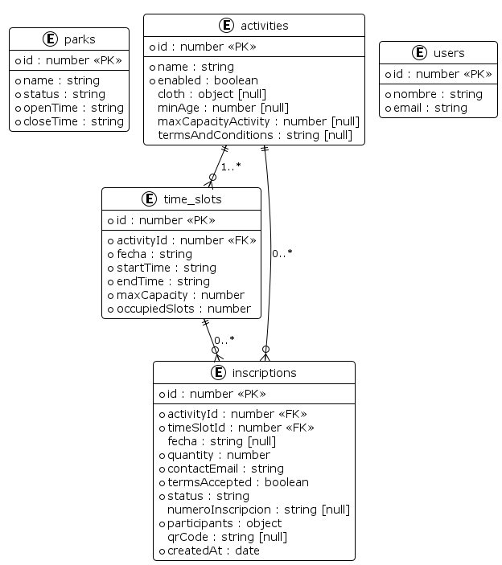
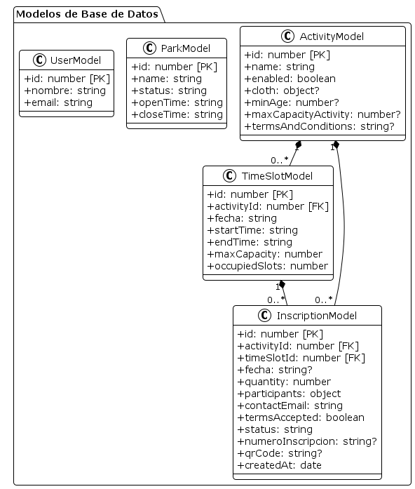

# Justificación de Decisiones de Diseño e Implementación (TDD)

**Cátedra:** Ingeniería de Software (ISW) — Unidad Nro. 4: Aseguramiento de Calidad de Proceso y de Producto  
**Proyecto:** EcoHarmony Park — Backend  
**Trabajo Práctico:** TP6 — Desarrollo Conducido por Pruebas (TDD)  
**User Story Asignada:** Inscribirme a actividad
**Metodología:** TDD (Red - Green - Refactor)

---

### Arquitectura en Capas Orientada a la Testeabilidad

Para el desarrollo de la User Story, se adoptó una **Arquitectura en Capas (Layered Architecture)**.

1. **Diseño desde el testing:** Al estructurar el código en capas los métodos y contratos públicos de las clases quedan expuestos y separados de las implementaciones concretas. Esto permitió diagramar la arquitectura y saber exactamente dónde colocar las aserciones de prueba antes de escribir código.
2. **Aislamiento de Dependencias y Mocks Livianos:** Las pruebas unitarias se ejecutan contra contratos de repositorios y helpers mockeados, sin necesidad de levantar bases de datos ni servicios externos.
3. **Facilidad para Futuras Pruebas de Integración:** Al desacoplar la lógica de aplicación de los adaptadores de infraestructura, pasar de mocks a pruebas de integración con base de datos real requiere únicamente conectar los repositorios concretos sin reescribir la lógica.
4. **Delimitación de Efectos Colaterales Fuera de la Transacción:** Servicios externos como el envío de correos (`EmailHelper`) y la generación de códigos QR (`QrHelper`) se segregaron en la capa de infraestructura. Esto garantiza que fallos en la red o en el servicio de correo no bloqueen ni formen parte del límite transaccional de la reserva en base de datos (`registerInscription`).

### Testing Segregado entre Validación de Entrada y Reglas de Negocio

La suite de 111 pruebas unitarias automatizadas se dividió en dos suites complementarias e independientes:
- `register-inscription.dto.test.ts` (57 tests)
- `inscription.service.test.ts` (54 tests)

**Sanitización de datos (DTO):**  

El `RegisterInscriptionDto` es la barrera de entrada al sistema encargada de sanitizar y validar sintácticamente los datos provenientes del frontend/cliente.

   * Formato estricto de fecha ISO (`YYYY-MM-DD`).
   - Validación sintáctica de dirección de correo electrónico (`emailContacto`).
   - Admisión de caracteres especiales válidos del idioma español.
   - Coherencia entre cantidad declarada y lista de participantes.
   - Pertenencia de talles de vestimenta al dominio permitido.

**Lógica de Negocio y Políticas del Parque (Servicio):**  

`InscriptionService` (método `registerInscription`) asume que los datos ya fueron sintácticamente sanitizados y se enfoca exclusivamente en aplicar las reglas de negocio:

   - Restricciones de edad mínima por actividad (`minAge`).
   - Capacidad máxima permitida por actividad (`maxCapacityActivity`).
   - Ventanas temporales de reserva (habilitación 24 horas antes y cierre 15 minutos previos al inicio).
   - Calendario operativo del parque (rechazo automático en días lunes y feriados fijos: 25 de diciembre y 1 de enero).
   - Verificación de cupos disponibles en el turno y prevención de solapamientos horarios por DNI de participante.

### Gestion del tiempo

Se implementó un helper estático de presentación (`TimeHelper`) para centralizar la conversión horaria y se expuso el endpoint `GET /api/time`.

1. **Estándar Universal (UTC) como Núcleo de Interoperabilidad:**  
   Internamente y hacia servicios externos o integraciones futuras hipoteticas, el sistema mantiene el estándar UTC. Esto evita conversiones dispersas en el código.
2. **Adaptador de Localización para el Parque y el Frontend:**  
   El bioparque físico opera en la zona horaria de Argentina (`America/Argentina/Buenos_Aires`, `-03:00`). `TimeHelper` actúa como un adaptador de presentación que traduce el tiempo universal al huso local:

   - Configuración de `hourCycle: 'h23'` para erradicar el defecto de formato (`T24:30`) entre las 00:00 y las 00:59.
   - Evaluación precisa de las políticas horarias del parque: habilitación de reservas dentro de las 24 horas previas y cierre estricto 15 minutos antes del inicio del turno.

3. **Sincronización Cliente-Servidor (GET /api/time):**  
   Dado que los visitantes acceden desde dispositivos móviles cuyos relojes pueden estar desfasados, manuales o en husos horarios diferentes, `GET /api/time` actúa como la fuente única de verdad del reloj del parque.

### Transacciones

Para garantizar la atomicidad en la reserva de cupos y creación de la inscripción, se implementó un decorador de método `@Transactional()` integrado con el soporte nativo de Continuation-Local Storage (`Sequelize.useCLS`) respaldado por `AsyncLocalStorage` de Node.js.

1. **Desacople entre Lógica de Negocio y Ciclo de Vida de Base de Datos:**  
La lógica de aplicación no debe contaminarse con operaciones de bajo nivel como `begin transaction`, `commit` o `rollback`. El decorador `@Transactional()` intercepta la ejecución y gestionando automáticamente la apertura, confirmación o reversión ante excepciones no controladas.
2. **DataSources y Repositorios Limpios de Parámetros de Infraestructura:**  
Al propagar la transacción activa de forma transparente a través de `AsyncLocalStorage`, los métodos de los repositorios y data sources mantienen las firmas de los metodos limpias, sin necesidad de propagar manualmente un objeto en cada llamada.
3. **Transparencia en Pruebas Unitarias:**  
Cuando la suite de pruebas unitarias de Jest se ejecuta sin base de datos activa o con repositorios mockeados, el decorador detecta la ausencia de una conexión activa de Sequelize y ejecuta el método de forma directa, permitiendo que los 111 tests corran en memoria a máxima velocidad sin efectos colaterales de infraestructura.

---

### Turnos

En la base de datos y en el dominio, cada turno es una instancia concreta planificada para una fecha específica (`fecha: 'YYYY-MM-DD'`), con su propia capacidad máxima y cupos ocupados (`occupiedSlots`). La base de datos se inicializa con el calendario completo planificado hasta el 31 de diciembre.

1. **Supuesto de Planificación Previa del Bioparque:**  

En la operativa real del parque, la definición y apertura de turnos corresponde a un proceso administrativo que ocurre en momentos y frecuencias desconocidas para el visitante. Dado que el alcance de la User Story asignada se restringe exclusivamente al flujo del visitante (*"Inscribirme a actividad"*), se adoptó el supuesto arquitectónico formal de que la administración del parque ya planificó y publicó el calendario de actividades de la temporada (hasta fin de año).

2. **Aislamiento de Cupos por Fecha y Cumplimiento de Contratos de Test:**  

Al materializar cada turno con su propia clave primaria (`id`), la reserva de cupos en una fecha no tiene posibilidad física de alterar la disponibilidad de otra fecha, cumpliendo el test de `test_inscripcion_en_una_fecha_no_modifica_cupos_de_otra_fecha`.

3. **Atomicidad y Concurrencia a Nivel de Fila (Row-Level Locking):**  

Permite que la reserva de cupos se ejecute como una sentencia SQL atómica sobre la fila exacta del turno, eliminando la necesidad de bloqueos globales de tabla.

---

### Ropa

En la capa de dominio, el requerimiento de vestimenta se modeló como una clase dedicada (`ClothEntity`) que valida talles (`isValidSize`). Sin embargo, en la base de datos no se creó una tabla `clothes`, sino que se almacena como una columna JSON.

1. **Modelado Evolutivo ante Requerimientos Incompletos:**  

En la fase actual del proyecto se desconoce el equipamiento que gestionará el bioparque en el futuro. Crear una tabla relacional normalizada hubiera sido incesesario. El almacenamiento en formato `JSON` permite evolucionar la estructura sin migraciones destructivas.

2. **Encapsulamiento de datos como Value Object:**  

A pesar de la flexibilidad en la persistencia, en el dominio se definio una clase`ClothEntity` que se comporta como un *Value Object* inmutable y encapsula la regla de validación de talles (`XS` a `XXL` y números de calzado permitidos).

### REST refactor y nomenclatura

En la fase final de refactorización, se eliminaron los endpoints basados en verbos RPC (`/inscriptions/register`, `/activities/:id/turnos`) y se adoptó una convención REST pura en inglés (`POST /api/inscriptions`, `GET /api/catalog/time-slots?activityId=&date=`).

1. **Fase REFACTOR en TDD:**  
   - Durante la **fase GREEN**, la premisa es construir el código mínimo indispensable para que las aserciones de prueba pasen. En esa instancia, la nomenclatura de controllers y endpoints emergió de forma rápida para validar el flujo funcional.
   - En la **fase REFACTOR**, una vez asegurado el comportamiento con las pruebas, se aplicó la disciplina de ingeniería: depurar el diseño, eliminar duplicados bilingües (`hora`/`startTime`, `cupoMaximo`/`maxCapacity`, `nombre`/`name`) y estandarizar la convención de URLs hacia sustantivos en plural en inglés.
1. **Convención Bilingüe:**  
   - **Inglés para el Acceso al Sistema y Código Fuente:** Endpoints, métodos, identificadores de código, controllers y rutas REST se definen en inglés como estándar técnico de la industria (`/api/inscriptions`, `/api/catalog/time-slots`).
   - **Español para el Dominio y el Usuario:** Los mensajes de error, términos y condiciones, descripciones y copys del correo se mantienen en español neutro, respetando la localización requerida por la User Story y la interfaz de usuario del bioparque.

---

### Diagrama Entidad-Relación de la Base de Datos (ERD)

### Diagrama de Clases de la Base de Datos

### Lenguaje del backend

Se seleccionó **TypeScript** ejecutado sobre el entorno de **Node.js** como lenguaje principal del backend.

1. **Unificacion de Lenguaje en Todo el Stack:**  
   Al ser JavaScript/TypeScript el lenguaje estándar tanto en el frontend (React con Vite) como en el backend (Node.js), se reduce el costo de cambio de contexto. Permite compartir modelos mentales de datos y estructuras de validación entre ambas partes del sistema.
2. **Familiaridad y Curva de Aprendizaje del Equipo:**  
   JavaScript/TypeScript es el ecosistema más extendido y popular de la industria, garantizando que todos los integrantes del equipo cuenten con una base sólida.
3. **Seguridad de Tipos en Tiempo de Compilación para TDD:**  
   TypeScript complementa la disciplina de TDD aportando un sistema de tipos estático: los contratos de entidades, repositorios y DTOs se validan antes de la ejecución. Esto previene errores comunes en tiempo de ejecución.

---

### Framework Web Express.js

Se adoptó **Express.js** como framework para la capa de entrega HTTP y ruteo de la API REST.

1. **Adecuación al Alcance de la User Story (Principio KISS y YAGNI):**  
   Al implementar una historia de usuario puntual Express tiene exactamente la infraestructura HTTP necesaria.
2. **Estándar Consolidado y Facilidad de Comprensión:**  
   Express es la librería HTTP más conocida, madura y documentada de Node.js. Esto aseguró que todos los miembros del equipo pudieran comprender de forma inmediata el ciclo de vida de peticiones/respuestas y los controladores, minimizando la fricción y el tiempo de incorporación.
---

### Base de datos

Se seleccionó **PostgreSQL** como motor de base de datos relacional y **Sequelize** como Object-Relational Mapping (ORM).

1. **Familiaridad y Mitigación del Riesgo Técnico:**  
   El equipo contaba con amplia experiencia y proyectos previos implementados con el stack PostgreSQL + Sequelize.
2. **Garantías ACID para el Modelo de Reservas y Cupos:**  
   La lógica de reserva de actividades demanda integridad referencial estricta, claves foráneas y atomicidad transaccional para evitar condiciones de carrera o sobreventa de cupos. PostgreSQL ofrece soporte robusto para transacciones concurrentes y almacenamiento híbrido.
3. **Integración Transaccional Limpia mediante CLS:**  
   Sequelize ofrece soporte maduro para Continuation-Local Storage , lo que habilitó la implementación desacoplada del decorador `@Transactional()` mediante `AsyncLocalStorage` de Node.js, manteniendo las firmas de los repositorios y data sources libres de parámetros de infraestructura.

---

### QR y mails

La emisión de credenciales de acceso y el despacho de confirmaciones se resolvió mediante `qrcode` y `nodemailer` integrado a **Brevo**.

1. **Generación en Memoria y Formato Base64 Data URL (Sin I/O de Disco):**  
   * Se utilizó la generación de códigos QR en memoria compactados como cadenas Base64
   - Esto Evita escribir archivos temporales en el disco y Facilita la manipulación y transporte del recurso: el QR viaja directamente como texto dentro el mail que se renderiza.
2. **Proveedor Transaccional Confiable (Brevo Relay):**  
   Para la salida de correos se seleccionó el relay SMTP de Brevo por tratarse de un proveedor transaccional probado en proyectos previos del equipo.
3. **Aislamiento Fuera del Límite Transaccional de Base de Datos:**  
   El despacho de correos electrónicos involucra latencia de red, por lo tanto el envío de mails se desacoplo y fuera del bloque `@Transactional()` garantizo que problemas en la red o demoras del servidor SMTP .

### Testing

Para ejecutar la disciplina de TDD en sus tres fases (Red, Green y Refactor), se utilizó **Jest** integrado con el compilador en memoria **`ts-jest`**.

1. **Estándar Formativo y Dominio por Parte del Equipo:**  
   Jest es la herramienta de testing promovida en la catedra de DDS que permitió que todos los miembros del equipo entendiera las pruebas.
2. **Adopción Rigurosa del Patrón AAA (Arrange - Act - Assert):**  
Los 111 tests unitarios siguen de manera estricta y explícita la división en tres fases:
   - **Arrange (Preparar):** Configuración de fixtures tipados, inicialización de repositorios mockeados y congelamiento del reloj del sistema.
   - **Act (Actuar):** Ejecución de la unidad de código bajo prueba.
   - **Assert (Afirmar):** Verificación exhaustiva de resultados esperados, códigos de error, mensajes exactos y contratos de llamadas a espías.

### Swagger
Se integró **Swagger UI** montado directamente sobre el servidor de Express en la ruta `/api/docs`.

1. **Documentación Ligera, Centralizada y Libre de Desincronización:**  
   Al servirse directamente desde el backend en tiempo de ejecución, la documentación de la API es un artefacto liviano que no requiere sincronizar manualmente archivos estáticos externos ni mantener colecciones de Postman que quedan obsoletas ante cualquier refactorización de código.
2. **Contrato Vivo y Comunicación Fluida con el Frontend:**  
   Swagger UI actúa como el contrato de interfaz vinculante entre frontend y backend. Quien desarrolla el front puede consultar en tiempo real los esquemas,  campos obligatorios, los códigos de error HTTP (400, 404, 500) y ejecutar pruebas interactivas directamente desde el navegador de manera facil.

